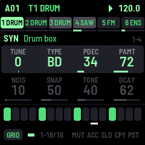
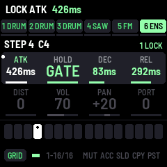
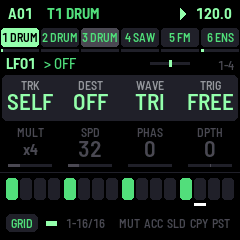
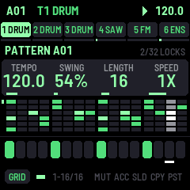

# MNM-1: firmware stile Monomachine per l'M-VAVE FM-1

MNM-1 è un firmware custom che trasforma l'**M-VAVE FM-1** in una **groovebox a sei tracce
monofoniche** ispirata all'**Elektron Monomachine**: ogni traccia ha la sua *macchina* di sintesi,
lo stesso percorso di filtri/inviluppi/effetti, tre LFO e il suo delay; uno step sequencer da 64
passi con **parameter lock**, trigless lock, slide, accent, swing, probabilità e arpeggiatore.

   

> **Stato: sperimentale, non ancora provato su hardware reale.** Il codice compila con il toolchain
> JieLi e passa tutti i test nel simulatore host (audio, schermo, LED, MIDI, salvataggio). La
> piattaforma (driver, USB, flash, updater) è quella di [Felucca](https://github.com/hugelton/Felucca)
> già collaudata dagli altri firmware della famiglia, e il pacchetto è **byte-identico a quello di
> FoMni** in tutto tranne l'app (boot head, update loader, tabelle). Il carico CPU reale va però
> verificato sul dispositivo (pagina GLO → CPU). Installare firmware custom è a proprio rischio: leggi
> [Installare in sicurezza](#installare-in-sicurezza).
>
> MNM-1 è un progetto indipendente: non è affiliato né approvato da Elektron, M-VAVE o Hügelton
> Instruments. "Monomachine" è un marchio di Elektron Music Machines.

---

## Indice

- [Il concetto](#il-concetto)
- [I controlli](#i-controlli)
- [Le pagine e i parametri](#le-pagine-e-i-parametri)
- [Le macchine](#le-macchine)
- [Il sequencer](#il-sequencer)
- [Pattern, kit e salvataggio](#pattern-kit-e-salvataggio)
- [MIDI](#midi)
- [Differenze dalla Monomachine](#differenze-dalla-monomachine)
- [Compilare, testare, installare](#compilare-testare-installare)
- [Installare in sicurezza](#installare-in-sicurezza)
- [Crediti e licenza](#crediti-e-licenza)

---

## Il concetto

| | |
| --- | --- |
| **Tracce** | 6, ognuna una voce monofonica |
| **Macchine** | 11: SAW (supersaw), PULS (pulse/PWM), ENS (ensemble/accordi), SID (chip 6581), FM (3 operatori), FMDY (FM con inviluppo d'indice), WAVE (wavetable), DRUM (8 percussioni), NOIS (rumore), PLUK (corda pizzicata), SINE (sinusoide con wavefolder e pitch envelope) |
| **Percorso per traccia** | macchina → filtro passa-alto + passa-basso (BASE / WIDTH, risonanze, inviluppo AD) → inviluppo d'ampiezza (ATK, HOLD, DEC, REL) → distorsione → EQ a campana → riduzione sample-rate → volume/pan → delay di traccia (sincronizzato al tempo, feedback filtrato) |
| **Modulazione** | 3 LFO per traccia, 7 forme d'onda, 5 modi di trigger, velocità a tempo; ognuno può puntare **qualsiasi parametro di qualsiasi traccia** (anche gli altri LFO) |
| **Sequencer** | fino a 64 step per pattern, note per step, accent, slide, 32 righe di parameter lock per pattern, trigless lock, swing 50–80 %, velocità 1/2x–2x, probabilità, arpeggiatore per traccia, sync MIDI clock in/out |
| **Memoria** | 32 slot (A01–A16, B01–B16), ognuno con un pattern e il suo kit, in flash |

Un **kit** sono le sei macchine con tutti i loro valori; un **pattern** sono gli step, le note e i lock.
Ogni slot contiene entrambi, come sui groovebox Elektron più recenti: cambiare pattern cambia anche i
suoni.

## I controlli

Il pannello dell'FM-1: 27 tasti (F3–G5), 14 pulsanti, 7 encoder infiniti, la manopola MASTER.

### Due modi dei tasti (pulsante SEQ)

**GRID** (SEQ acceso): i 16 tasti bianchi sono i 16 step della traccia selezionata.

| Azione | Effetto |
| --- | --- |
| tap su un tasto bianco | step on / off (spegnerlo cancella anche i suoi lock) |
| tenere uno step + girare KNOB 1–4 | **parameter lock** del parametro sulla pagina corrente, solo su quello step |
| tenere più step + girare | lock su tutti gli step tenuti |
| tenere uno step vuoto + girare | **trigless lock**: cambia il suono da quello step senza suonare una nota |
| tenere uno step + PRESETS | nota dello step (semitoni) |
| tenere uno step + ALGORITHM | ottava della nota dello step |
| tasti neri 1–6 | seleziona la traccia 1–6 |
| nero **MUT** | tap: muta/attiva la traccia selezionata; tenuto + tasto traccia: muta quella traccia |
| nero **ACC** tenuto + step | accent on/off |
| nero **SLD** tenuto + step | slide (legato con glide) on/off |
| nero **CPY** | copia la traccia (suono + step + lock) |
| nero **PST** | tap: incolla step, note e lock; tenuto: incolla anche il suono |
| CPY tenuto + PST | cancella la traccia |
| OCT− / OCT+ | pagina di step (1–16, 17–32, …) per pattern più lunghi di 16 |

I LED: step con trig accesi, step con soli lock in luce tenue, lo step in esecuzione invertito; tasti
neri: traccia selezionata accesa, tracce attive in luce tenue, tracce mute spente.

**KEYS** (SEQ spento): tutti i 27 tasti suonano la traccia selezionata in cromatico (da F),
OCT−/OCT+ cambiano ottava (±3). Con l'arpeggiatore attivo i tasti tenuti vengono arpeggiati.

### Pulsanti ed encoder

| Controllo | Effetto |
| --- | --- |
| **PLAY** | start / stop |
| **REC** | registrazione: in KEYS mentre suona, le note finiscono sullo step più vicino; da fermo, *step entry* (ogni nota sul prossimo step); le manopole girate mentre suona registrano lock sugli step con trig |
| **EDIT** | pagina SYN (parametri della macchina); di nuovo: valori 5–8 |
| **ENV** | pagina AMP |
| **SEL** | pagina FILT |
| **FX** | pagina FX |
| **LFO** | pagine LFO1 → LFO2 → LFO3 (ogni pressione: metà successiva) |
| **ARP** | pagina TRK (arpeggiatore, gate, accent, probabilità, trasposizione) |
| **HOME** | pagina PATTERN: tempo, swing, lunghezza, velocità + panoramica di tutte le tracce |
| **GLO** | impostazioni globali (MIDI, clock, follow, tema, CPU) |
| **SAVE** | tap: salva pattern + kit nello slot; tenuto + PRESETS: "salva come" in un altro slot (copia), al rilascio; tenuto a lungo: **CLEAR?** (SAVE di nuovo: cancella il pattern; REC: anche il kit) |
| **SELECT** | traccia |
| **ALGORITHM** | macchina della traccia (sulla pagina SYN; i parametri SYN tornano ai default della macchina) |
| **PRESETS** | slot del pattern: da fermo si carica quando smetti di girare; mentre suona parte alla fine del pattern corrente (in alto lampeggia `A01>A05`) |
| **KNOB 1–4** | i quattro valori della riga attiva della pagina |
| **MASTER** | volume |
| OCT− + OCT+ tenuti 5 s | modalità aggiornamento (per l'installer) |
| OCT− + OCT+ all'accensione | calibrazione del pannello |

## Le pagine e i parametri

Ogni pagina ha 8 valori su due righe; i KNOB 1–4 controllano la riga evidenziata, premere di nuovo il
pulsante della pagina passa all'altra riga. I valori vanno da 0 a 127 (o i nomi di un elenco).

| Pagina | 1 | 2 | 3 | 4 | 5 | 6 | 7 | 8 |
| --- | --- | --- | --- | --- | --- | --- | --- | --- |
| **SYN** | (della macchina: vedi sotto) | | | | | | | |
| **AMP** | ATK attacco | HOLD tenuta (127 = GATE: finché la nota è tenuta) | DEC decadimento | REL rilascio (solo con HOLD = GATE) | DIST distorsione | VOL | PAN | PORT portamento |
| **FILT** | BASE taglio passa-alto | WDTH ampiezza: il passa-basso sta sopra BASE di WDTH | HPQ risonanza HP | LPQ risonanza LP | FATK attacco inviluppo filtro | FDEC decadimento | BOFS inviluppo → BASE (±) | WOFS inviluppo → WDTH (±) |
| **FX** | EQF frequenza EQ | EQG guadagno EQ (±18 dB) | SRR riduzione sample-rate | DTIM tempo delay (in ottavi di step) | DSND mandata | DFB feedback | DHP passa-alto nel feedback | DLP passa-basso nel feedback |
| **LFO1-3** | TRK traccia di destinazione (SELF, T1–T6) | DEST parametro | WAVE (TRI SIN SQR SAW RAMP EXP RND) | TRIG (FREE, TRIG riparte con la nota, HOLD campiona alla nota, ONE un ciclo, HALF mezzo ciclo) | MULT ×1…×128 | SPD velocità | PHAS fase di partenza | DPTH profondità (±) |
| **TRK** | ARP (OFF UP DOWN U-D RND) | ASPD velocità arpeggio (1/64…1/4) | ARNG ottave 1–4 | ACHD accordo | GATE durata nota (in sedicesimi di step) | ACNT quantità accent | PROB probabilità del trig | TRNS trasposizione traccia |

Velocità LFO: `SPD × MULT = 128` fa un ciclo ogni 16 step (una battuta a 1x).
Tutti i parametri di tutte le pagine si possono lockare per step e modulare con gli LFO (DEST copre
SYN, AMP, FILT, FX e i parametri degli LFO; la pagina TRK si può lockare ma non modulare).

## Le macchine

Per tutte le macchine il valore 1 è **TUNE** (semitoni, ±64); dove c'è, il 2 è **FINE** (±1 semitono).

| Macchina | 3 | 4 | 5 | 6 | 7 | 8 |
| --- | --- | --- | --- | --- | --- | --- |
| **SAW** supersaw | DET detune | VOIC voci 1–7 | SUB sub-ottava | NOIS rumore | DRFT deriva analogica | BRIT brillantezza |
| **PULS** pulse | PW larghezza | PWM profondità | PWMS velocità PWM | SUB | DET 2° oscillatore | NOIS |
| **ENS** ensemble | CHRD accordo (OCT 5TH MAJ MIN SUS4 MAJ7 MIN7 DOM7 MAJ6 DIM AUG MIN9) | WAVE saw→square | DET | SPRD apertura del voicing | BRIT | SUB |
| **SID** chip 6581 | WAVE (TRI SAW PULS NOIS e combinazioni AND) | PW | PWM | O2TN intonazione osc. 2 (±24) | RING ring-mod | BITS riduzione bit |
| **FM** 3 operatori | RAT1 rapporto op. 2 | IDX1 indice | RAT2 rapporto op. 3 | IDX2 indice | FB feedback op. 3 | ALGO (3>2>1, 2+3>1, 3>1+2, 1+2+3) |
| **FMDY** FM dinamica | RAT | IDX indice base | IATK attacco indice | IDEC decadimento indice | IENV quantità inviluppo (±) | FB |
| **WAVE** wavetable | WAV posizione (8 onde: sine, tri, saw, square, pulse, organ, vowel, metal) | WMOD inviluppo → posizione (±) | WDEC decadimento | FOLD wavefolder | BITS | SYNC hard sync |
| **DRUM** (2 = TYPE: BD SD HH CL HH OP CLAP TOM RIM BELL) | PDEC decadimento pitch | PAMT quantità pitch | NOIS rumore | SNAP click | TONE tono | DCAY decadimento |
| **NOIS** (2 = COLR colore ±) | SH sample&hold legato alla nota | BITS | DENS densità (dust) | RING ring-mod | SINE sinusoide | RESO passa-banda risonante sulla nota |
| **PLUK** corda | DCAY decadimento | TONE | PICK posizione del plettro | EXCT rumore → impulso | BRST lunghezza eccitazione | STIF rigidità |
| **SINE** | FOLD wavefolder | DRIV saturazione | SUB | OCT2 ottava sopra | PDEC decadimento pitch | PAMT pitch envelope (cassa!) |

Le DRUM usano i propri inviluppi: scegliendole, l'AMP passa a HOLD 0 / DEC lungo (e torna indietro
scegliendo un'altra macchina). La nota suonata traspone il suono rispetto al C4.

## Il sequencer

- **Lunghezza** 1–64 step, **velocità** 1/2x 3/4x 1x 3/2x 2x, **swing** 50–80 % (pagina HOME).
  Il tempo (30–300 BPM) è globale.
- **Parameter lock**: ogni step può fissare qualsiasi valore di qualsiasi pagina della sua traccia;
  32 righe per pattern (una riga = una coppia traccia/parametro con un valore per ogni step: un
  parametro lockato su tutti i 64 step occupa una sola riga). Il lock vale dalla nota di quello step
  fino al trig successivo della traccia.
- **Trigless lock**: un lock su uno step senza trig cambia il suono della nota che sta suonando
  (es. aprire il filtro a metà di una nota lunga).
- **Slide**: la nota scivola dalla precedente senza riattaccare gli inviluppi (tempo = PORT, o 60 ms).
- **Accent**: volume più alto secondo ACNT.
- **PROB**: probabilità che il trig suoni (lockabile: probabilità diversa per step).
- **Arpeggiatore** (pagina TRK): un trig suona l'accordo ACHD su ARNG ottave a velocità ASPD fino al
  trig successivo; in KEYS arpeggia i tasti tenuti.
- **MIDI clock**: segue il clock in ingresso (start/stop/continue, 6 tick per step a 1x, swing
  incluso) e può mandarlo in uscita.
- **Mute** per traccia (MUT), non salvati.

## Pattern, kit e salvataggio

- 32 slot, A01–B16. Al primo avvio A01 contiene una **demo** (cassa, rullante, hi-hat, basso con
  slide e accent, stab FM con un lock, pad ENS con LFO sul filtro); gli altri slot partono con lo
  stesso kit e il pattern vuoto.
- **PRESETS** cambia slot (da fermo: caricato quando smetti di girare; mentre suona: alla fine del
  pattern, come sulla Monomachine).
- **Salvataggio automatico**: qualche secondo dopo una modifica, a sequencer fermo e in silenzio
  (scrivere in flash zittisce l'audio per un attimo, quindi mentre suona le modifiche restano in RAM,
  anche passando ad altri pattern). **SAVE** salva subito.
- **SAVE tenuto + PRESETS** → "salva come" in un altro slot; **SAVE tenuto a lungo** → CLEAR?.

## MIDI

USB-MIDI e ingresso MIDI TRS.

| Messaggio | Effetto |
| --- | --- |
| Note on/off sul canale **AUTO** (default 1) | suonano la traccia selezionata (registrate con REC) |
| Note sui canali traccia (default 2–7) | suonano le tracce 1–6 |
| CC 16–79 sul canale di una traccia | i suoi 64 valori in ordine (CC 16 + pagina × 8 + posizione), scalati sul range; tranne il 64 (pedale sustain, ignorato) |
| CC 7 / CC 10 | volume / pan della traccia |
| CC 120 / 123 | tutte le note off |
| Program change sul canale AUTO | slot 0–31 |
| Clock, Start, Continue, Stop | sync del sequencer (se CLK IN è ON) |
| Uscita (MIDI OUT ON) | le note del sequencer e dei tasti sui canali traccia; clock e start/stop se CLK OUT è ON |

Pagina GLO: TRK CH (canali delle tracce), AUTO CH, CLK IN, CLK OUT, MIDI OUT, FOLLOW (la griglia
segue la pagina di step in esecuzione), THEME (GREEN AMBER CYAN RED MONO), CPU (carico audio).

## Differenze dalla Monomachine

MNM-1 riprende il modo di lavorare della Monomachine (sei tracce mono, macchine, pagine di 8
parametri, parameter lock, trigless lock, LFO incrociati tra tracce, delay per traccia, cambio
pattern a fine giro) ma non è un clone: le macchine sono implementazioni originali ispirate alle
famiglie della MnM (SWAVE, SID, FM+, DPRO, GND), non c'è la macchina VO (sintesi vocale), né il
song mode, né le macchine di effetto/neighbour, e kit e pattern stanno insieme nello slot. Il
pannello dell'FM-1 ha 4 manopole: ogni pagina mostra 8 valori su due righe.

## Compilare, testare, installare

Vedi [BUILDING.md](BUILDING.md). In breve:

```
python3 -m venv .venv && .venv/bin/pip install -r requirements.txt && . .venv/bin/activate
tools/get_toolchain.sh && tools/get_sdk.sh      # toolchain JieLi e 3 file dell'SDK AC79
./build.sh                                      # -> build/mnm.fwsc
tests/run_tests.sh                              # motore, piattaforma, scenari UI nel simulatore
python3 tools/fm1_install.py --info             # trova l'FM-1 senza scrivere nulla
python3 tools/fm1_install.py build/mnm.fwsc     # installa
```

Il simulatore host (`build/host/mnm_host SCRIPT OUTDIR`) esegue l'intero firmware (UI, sequencer,
motore) su un computer, guidato da script in `tests/scenarios/*.mnm`, e produce screenshot PNG,
audio WAV, LED e log MIDI. I WAV di ogni macchina e della demo finiscono in `build/host/wav/`.

## Installare in sicurezza

Le protezioni sono quelle della famiglia Felucca, invariate:

1. **La modalità di aggiornamento del chip non si può sovrascrivere**: i primi 16 KiB della flash
   (boot JieLi, USB 4C4A:8057) non vengono mai scritti.
2. **Un firmware che si blocca all'avvio ripiega**: dopo due avvii falliti l'FM-1 parte in *safe
   mode* (niente audio, USB attivo, l'installer funziona); dopo quattro entra nella modalità
   aggiornamento del chip.
3. **Il pacchetto è verificato**: `tools/check_fwsc.py` controlla ogni CRC e, con `--ref`, che tutto
   tranne l'app sia identico byte per byte al pacchetto di FoMni (verificato in questo repo).

Prima di installare scarica il firmware originale M-VAVE (m-vave.com/download, FM-1 V15, "PC
Firmware") e conservalo: `tools/fm1_rescue.py` rimette quello se l'FM-1 finisse in un ciclo di crash.
Altrimenti il recupero passa da [FM-1-transporter](https://github.com/kurogedelic/FM-1-transporter).

Nota: i pattern occupano l'area dati che Felucca usa per i suoi preset e campioni utente (0x97000–
0xD6FFF): passando da un firmware all'altro i dati salvati dell'uno possono sparire.

## Crediti e licenza

MNM-1 è software libero sotto **GPL-3.0-only** (vedi [LICENSE](LICENSE) e [LICENSING.md](LICENSING.md)).
È costruito sulla piattaforma di **[Felucca](https://github.com/hugelton/Felucca)** di Leo Kuroshita
(Hügelton Instruments), passando per **[X0X](https://github.com/charlesvestal/fm1-x0x)** e
**[FoMni](https://github.com/charlesvestal/fm1-fomni)** di Charles Vestal e
**[FiMba-1](https://github.com/jadamsowers/fm1-fimba)** di jadamsowers: driver, USB, flash, update
loader, installer, safe mode e simulatore host vengono da loro. Il motore a sei tracce, le macchine,
il sequencer con i lock, la UI e i test sono di MNM-1.

MNM-1 è stato scritto con Claude Code (Anthropic) su richiesta dell'autore del repository.
